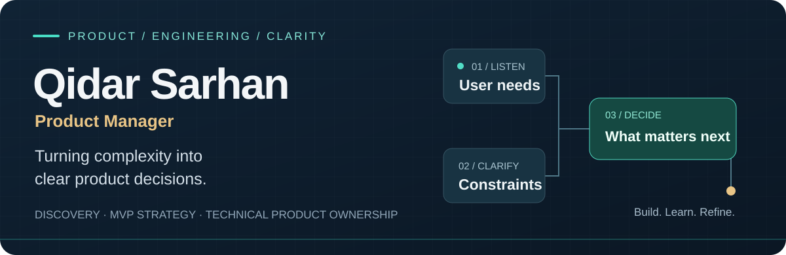
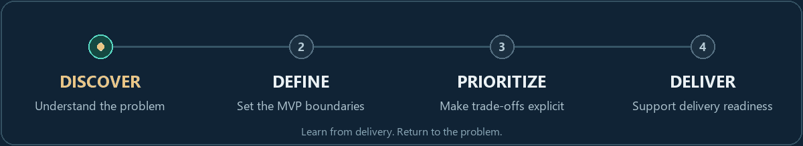

  

# Qidar Sarhan · Product Manager

**Technical Product Management · Product Discovery · Business Analysis · ERP & SaaS**

I help turn complex business needs into **clear requirements, focused MVPs, and practical delivery plans**. My background combines **3+ years in product work and business analysis** with **9+ years in software delivery**—connecting the business problem with the engineering decisions behind it.

**Cairo, Egypt** · Arabic: native · English: professional working proficiency 
[Connect on LinkedIn ↗](https://www.linkedin.com/in/qidarmohamed/) · Open to product roles and freelance or project-based collaboration

أحوّل احتياجات العمل إلى متطلبات واضحة، ونطاق منتج قابل للتنفيذ، وأولويات يفهمها أصحاب المصلحة وفريق التطوير.

## From a business problem to a clear next step

  <picture>
    <source media="(max-width: 640px)" srcset="assets/product-flow-mobile.png" />
    <source media="(prefers-reduced-motion: reduce)" srcset="assets/product-flow-static.png" />
    
  </picture>

**01 / Product discovery** 
Understand the business need, users, workflows and constraints before choosing a solution.

**02 / MVP & requirements** 
Translate the problem into a focused MVP, PRD or BRD, user stories and acceptance criteria.

**03 / Technical product ownership** 
Clarify priorities and trade-offs with engineering, including APIs, data and integration requirements.

I care about the decisions behind the backlog: **what problem matters, what belongs in scope, and what the team needs to move forward**. I connect business analysis with engineering context to make those decisions explicit and keep stakeholders aligned.

## Selected product experience

### ERP & inventory workflows

Translated operational needs into requirements, epics, user stories and acceptance criteria for inventory workflows and accounting integrations. My contribution focused on **requirements and scope prepared for development**. Client identity and internal artifacts remain confidential.

### Digital health & education

Worked on discovery, user segmentation, customer journeys and requirements for digital health, spanning connected commerce, content, coaching and CRM capabilities through planning and early implementation. For education and community platforms, prepared **BRD/SRS/PRD documentation, MVP boundaries and phased delivery plans**.

### SaaS, point of sale & e-commerce

Worked on subscription plans, trial flows and admin operations for a SaaS point-of-sale product. My engineering experience with e-commerce, payments, APIs and databases helps me discuss feasibility and implementation trade-offs with developers.

*These examples describe my contribution and project stage. They do not imply that every scoped capability has launched or achieved adoption.*

## Product thinking, grounded in engineering

- **Product management & business analysis:** product discovery, requirements gathering, MVP scoping, backlog prioritization, customer journeys and stakeholder alignment.
- **Product documentation:** BRD, PRD, SRS, user stories, acceptance criteria and business rules.
- **Technical collaboration:** PHP, Laravel, REST APIs, MySQL, database design and payment integrations.
- **AI & automation:** AI-assisted research and documentation, prompt/context engineering, MCP and n8n workflows.

<strong>Explore my earlier public engineering work</strong>

These repositories show part of my software background; they are not presented as product-management case studies.

- [E-commerce website](https://github.com/QidarSarhan/E-commerce_website) — implementation with a service/repository pattern example.
- [Task management](https://github.com/QidarSarhan/manage_tasks)
- [Finance management system](https://github.com/QidarSarhan/finance-management-system-project)
- [News & blog project](https://github.com/QidarSarhan/News-site_Blog_project)

Forked repositories are learning/reference resources; original authorship remains with their respective maintainers.

## Let's talk product

Interested in **Product Manager, Technical Product Manager and Product Owner** opportunities across Egypt and the Gulf, including remote work and suitable relocation opportunities. I also support **product discovery, MVP scoping and requirements work** on a freelance or project basis.

**[Start a conversation on LinkedIn →](https://www.linkedin.com/in/qidarmohamed/)**
